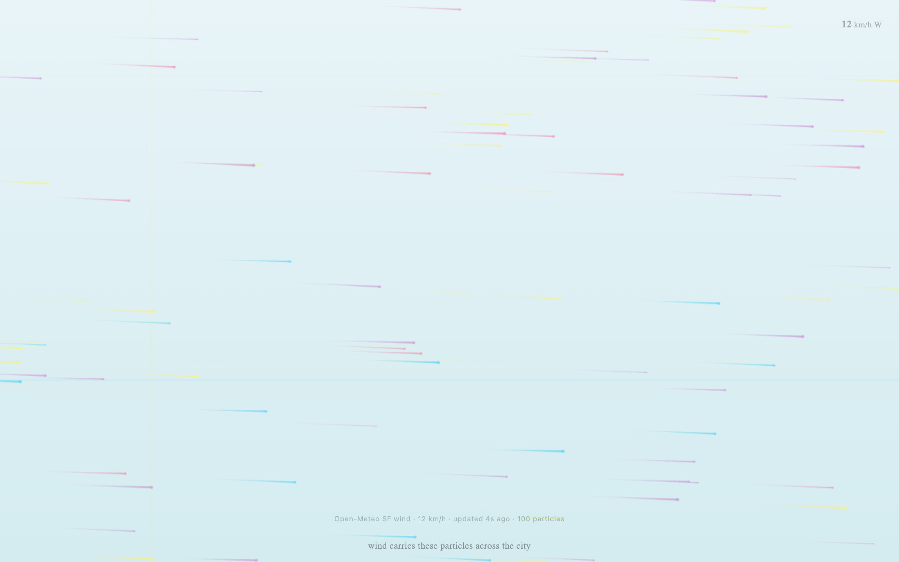

<div align="center">

<h1>drift</h1>

<p><b>Pastel particles riding San Francisco's wind.</b></p>

<p><i>A hundred trails cross the screen at the speed and heading of the wind over the city right now.</i></p>

<h6>


</h6>

<a href="https://parthchandak02.github.io/drift/"><b>Live demo</b></a> ·
<a href="#how-it-works"><b>How it works</b></a> ·
<a href="#run-it"><b>Run it</b></a>

<br><br>

<a href="https://parthchandak02.github.io/drift/"></a>

<sub>Live capture, 22 October 2026. Real wind data: 12 km/h from the west.</sub>

</div>

<br>

drift is a single HTML file with no dependencies. On load it asks the free
[Open-Meteo](https://open-meteo.com) forecast API for the current wind at San Francisco
(37.77° N, 122.42° W), turns it into one velocity vector and lets 100 particles ride it.
Each particle wobbles a little on its own, so the field reads as air rather than rain.

## How it works

| Data (Open-Meteo `current_weather`) | Drives |
|---|---|
| `winddirection` | Heading of every particle: the wind blows *from* this bearing, so a west wind sends trails to the right |
| `windspeed` | How fast the particles move (km/h × 0.18 px per frame) |

- Each particle gets one of four pastel colours, a 1 to 3 px head and a 60-frame fading trail.
- A slow sine-based drift and a gentle per-particle oscillation are added on top of the wind.
- Particles that leave the screen wrap around to the opposite edge.
- The top-right corner shows speed and compass direction; the line at the bottom shows the
  source, speed, seconds since the fetch and the particle count.

Tap or click anywhere for a gust that pushes nearby particles outward and a panel with the
speed, compass bearing and data source; it fades after three seconds.

The wind is re-fetched every ten minutes. If the first request fails the piece uses 15 km/h
from the south and the bottom line reads `fallback wind (Open-Meteo unavailable)`; if a later
refresh fails, the last live reading stays and its age keeps counting.

## Run it

```bash
git clone https://github.com/parthchandak02/drift.git
cd drift
python3 -m http.server 8000   # then open http://localhost:8000
```

Or just open `index.html` in a browser. The live version is served by GitHub Pages from the
default branch.

Part of the [daily generative builds](https://github.com/parthchandak02/parthchandak02#featured-projects)
series: [tessellate](https://parthchandak02.github.io/tessellate/) ·
[flora](https://parthchandak02.github.io/flora/) · [grow](https://parthchandak02.github.io/grow/) ·
[trace](https://parthchandak02.github.io/trace/) · [resonate](https://parthchandak02.github.io/resonate/) ·
[swell](https://parthchandak02.github.io/swell/) · [flux](https://parthchandak02.github.io/flux/)

<br>

<div align="center">
<sub>Built with plain Canvas 2D in one HTML file. Wind data from Open-Meteo.</sub>
</div>
